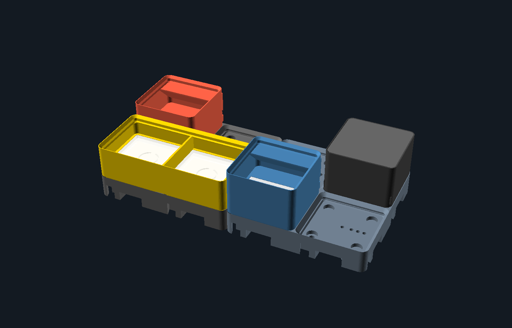

# Smart Gridfinity

A Gridfinity storage system, written in OpenSCAD, with an optional powered layer: each bin
carries an ID chip and a light under every compartment, so software can light the compartment
that holds an item. Bases work flat on a desk or on a wall with magnets.

**Status: design stage.** The models, boards and checks agree with each other, but nothing
has been printed, no board has been ordered or reviewed by a person, and there is no firmware.

## What is here

| Folder | Contents |
|---|---|
| `lib/`, `parts/` | OpenSCAD sources: plain baseplates and bins, smart tiles, smart bins, power bin, drawer unit, jar sleeves, tile keys |
| `assembly.scad`, `assembly_smart.scad` | Assembled views used for the pictures |
| `pcb/` | The five circuit boards as KiCad files, generated by Python scripts |
| `tests/` | Design checks: fit, contacts, power, grid layout |
| `docs/smart/` | The design page (`design.html`) and the materials list (`parts.md`) |
| `tools/` | `guild-refresh.sh` rebuilds the Guild knowledge graph in the order that keeps the code structure |
| `docs/HISTORY.md` | Earlier designs and why they were dropped. Background only |

## How the smart system works

- Bins have no radio and no processor: a round board in the foot has four contact rings, an
  ID chip and a connector for the bin's lights.
- Under every row of cells in a tile sits one board with spring pins. The first row's board
  has the radio module and a 5 V converter; further rows are joined by short flat cables.
- A power bin on a starter tile feeds 12–24 V into the grid and talks to your network.
- Tiles are 2×2 to 4×4 cells and join with printed keys and edge connectors, without screws.

Open `docs/smart/design.html` in a browser for pictures and the full description.

## Build

Needs OpenSCAD 2021.01 or newer. Printable files go to `build/`, which is not in the repository.

    ./build.sh          # plain parts
    ./build_smart.sh    # smart parts

Sized for a 256 mm print bed.

## Checks

Needs Python 3, OpenSCAD and, for the boards, KiCad 10.

    tests/run_all.sh    # contacts, power, grid layout, fit (the fit checks take over 10 minutes)

See `pcb/README.md` for the board checks.

## Licence

MIT. See `LICENSE`. This covers the OpenSCAD models, the scripts and the board designs.
