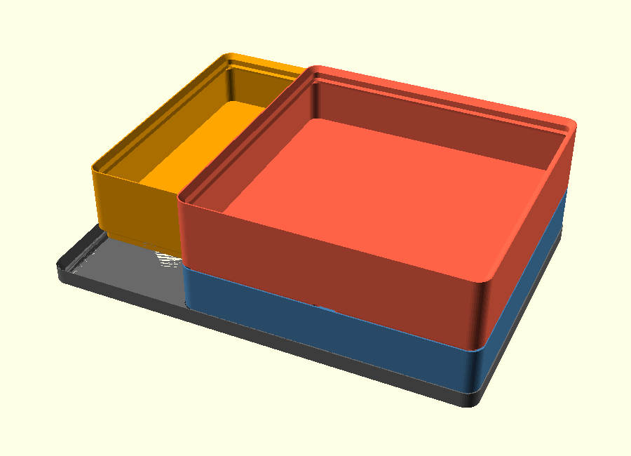

# Smart Gridfinity

**A smart storage system built on Gridfinity: it knows where every bin is, and it can point
to the one you need.**

[Gridfinity](https://gridfinity.xyz/) is an open, modular storage standard: a 42 mm grid of
baseplates and bins that you print yourself. Smart Gridfinity keeps that standard and adds
two things to it:

- **Location tracking.** Every bin carries a small ID chip. The base reads which bin stands
  on which cell, so the system always has a current map of your storage. Move a bin, or
  rearrange the whole grid, and the map follows without any setup.
- **Signalling.** Every compartment has a light under a clear floor. Ask your software, or
  an AI agent, for a part and the compartment that holds it lights up.

Around those two ideas the design aims for:

- **Bins that stay simple.** No battery, no radio and no processor in a bin. It gets power
  and data through four contacts in its foot, and works at any quarter turn.
- **A grid that grows.** Tiles snap together edge to edge and discover their neighbours.
  One power feed runs many tiles, flat on a desk or on a wall with magnets.
- **Optional smartness.** Plain Gridfinity bins and baseplates still fit and are included.
  Powered parts are an addition, not a requirement.
- **No soldering at the printed parts.** The circuit boards arrive assembled and plug or
  screw in.

Everything is open source: the OpenSCAD models, the circuit boards (KiCad, generated from
Python), and the checks that keep the two in agreement.

**Status: design stage.** The models, boards and checks agree with each other, but nothing
has been printed, no board has been ordered or reviewed by a person, and there is no
firmware or software yet.

## Explore

| Start here | |
|---|---|
| **[How it works](docs/how-it-works.md)** | The whole system explained with pictures, in about ten minutes |
| [Parts guide](docs/parts-guide.md) | Every printed part and board, which file makes it, how to print |
| [Status and open questions](docs/status.md) | What has been checked, and what has not |
| [Glossary](docs/glossary.md) | Tile, cell, row board, power cell and the rest |
| [All documentation](docs/README.md) | Index by what you want to do |

## What is in the repository

| Folder | Contents |
|---|---|
| `lib/`, `parts/` | OpenSCAD sources: plain baseplates and bins, smart tiles, smart bins, power bin, drawer unit, jar sleeves, tile keys |
| `assembly.scad`, `assembly_smart.scad` | Assembled views used for the pictures |
| `pcb/` | The five circuit boards as KiCad files, generated by Python scripts. See [`pcb/README.md`](pcb/README.md) |
| `tests/` | Design checks: fit, contacts, power, grid layout. See [`tests/README.md`](tests/README.md) |
| `docs/` | Documentation, the materials list and the illustrated design page |
| `tools/` | Helper scripts for the project's AI tooling |

## The smart system in four lines

- Bins have no radio and no processor: a round board in the foot has four contact rings, an
  ID chip and a connector for the bin's lights.
- Under every row of cells in a tile sits one board with spring pins. The first row's board
  has the radio module and a 5 V converter; further rows are joined by short flat cables.
- A power bin on a starter tile feeds 12–24 V into the grid and talks to your network.
- Tiles are 2×2 to 4×4 cells and join with printed keys and edge connectors, without screws.

The full walk-through is in [How it works](docs/how-it-works.md).

## Build

Needs OpenSCAD 2021.01 or newer. Printable files go to `build/`, which is not in the repository.

    ./build.sh          # plain parts
    ./build_smart.sh    # smart parts

Sized for a 256 mm print bed.

Ready-made STL files are attached to the [releases](https://github.com/lookatitude/smart-gridfinity/releases). They are untested.

## Checks

Needs Python 3, OpenSCAD and, for the boards, KiCad 10.

    tests/run_all.sh    # contacts, power, grid layout, fit (the fit checks take over 10 minutes)

See `pcb/README.md` for the board checks.

## Licence

MIT. See `LICENSE`. This covers the OpenSCAD models, the scripts and the board designs.
