# How it works

Smart Gridfinity is a Gridfinity base that knows which bin stands where, and bins that can
light up one compartment at a time. This page walks through the whole system. Nothing here
has been built yet: see [Status](status.md) for what is verified and what is not.

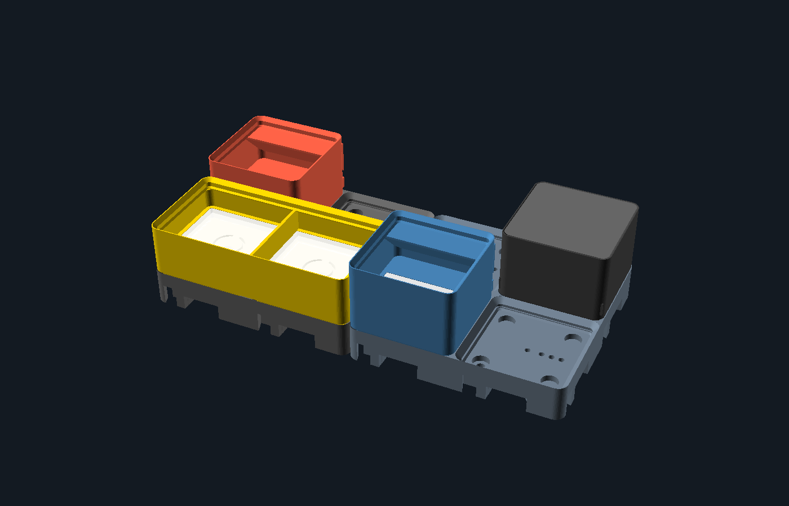

*The smallest useful set: two 2×2 tiles joined edge to edge, a 2×1 bin, two 1×1 bins and the
dark power bin. The pale compartment floors are clear and glow when called.*

## Four words

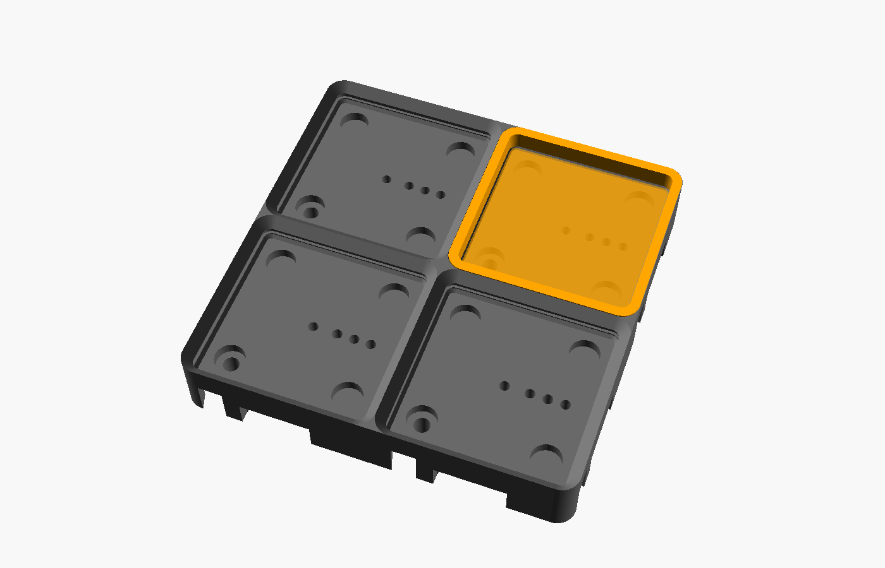

- **Tile:** one printed piece of the base. Any size from 2×2 to 4×4 cells.
- **Cell:** one 42 mm socket in a tile. It has four spring pins and four magnets.
- **Bin:** one container. It covers one or more cells and carries one small board with an ID chip.
- **Compartment:** one walled space inside a bin, with its own light.

More terms are in the [glossary](glossary.md).

## The two features

### Location tracking

- **Which bin is on which cell.** The tile steps through its cells and reads the ID chip of
  whatever stands on each one. The cell is known from the step, so nothing is measured.
- **How big a bin is.** A bin larger than one cell shows the same ID in two opposite corner
  cells. The rectangle between them is its footprint, also across tile joints.
- **Which tile is next to which.** Each edge connector has a neighbour pin. Over it, a tile
  tells the tile it touches its name and port number, so the hub can place every tile.

Move a bin and the old cells read empty while the new ones read its ID. The map follows.

### Signalling

Each compartment has a clear false floor with one addressable LED under it. The tile sends
light commands to one cell at a time, and the bin passes them along its chain of LEDs.

"Find the cadmium yellow" then works like this:

1. You place a bin. The hub records "bin 0x3A is on tile A, cells 1 to 2".
2. You tell the software once what is in it: "compartment 1 holds cadmium yellow".
3. You ask for cadmium yellow. The hub tells that tile to light compartment 1 of that bin.
4. You move the bin. The map updates without any input.

The software and firmware for this do not exist yet.

## Who does what

| Part | Contains | Job |
|---|---|---|
| Tile | Magnets, one row board under each row of cells | Holds bins, makes 5 V, reads the ID under each cell, sends light commands, reports its neighbours by radio |
| Bin | Magnets, one bin board, one LED per compartment | Presents its ID, passes power and light commands to its LEDs |
| Starter tile | A normal tile with one power cell | Takes the feed from the power bin and passes it to every tile |
| Power bin | Power board: DC input, fuse, hub radio | Brings 12–24 V in, collects the tile reports, holds the map, talks to your software |

Bins have no battery, no radio and no processor. Only the tiles and the power bin use radio.

## Contacts between bin and tile

Each cell has four spring pins in a row from its centre. The bin board has a centre pad and
three rings, so a bin works whichever way round you drop it in.

| Pin | Distance from cell centre | Carries |
|---|---|---|
| Centre | 0 mm | ID |
| Ring 1 | 5.4 mm | Light commands |
| Ring 2 | 9.2 mm | 5 V |
| Ring 3 | 12.9 mm | Ground |

The magnets carry no electricity. They only pull the bin board onto the pins. Flat, gravity
helps; on a wall, two snap latches on the bin foot click into a groove in the socket.
Standard Gridfinity bins still fit these sockets, unpowered.

## The tile

| Top | Underside |
|---|---|
| 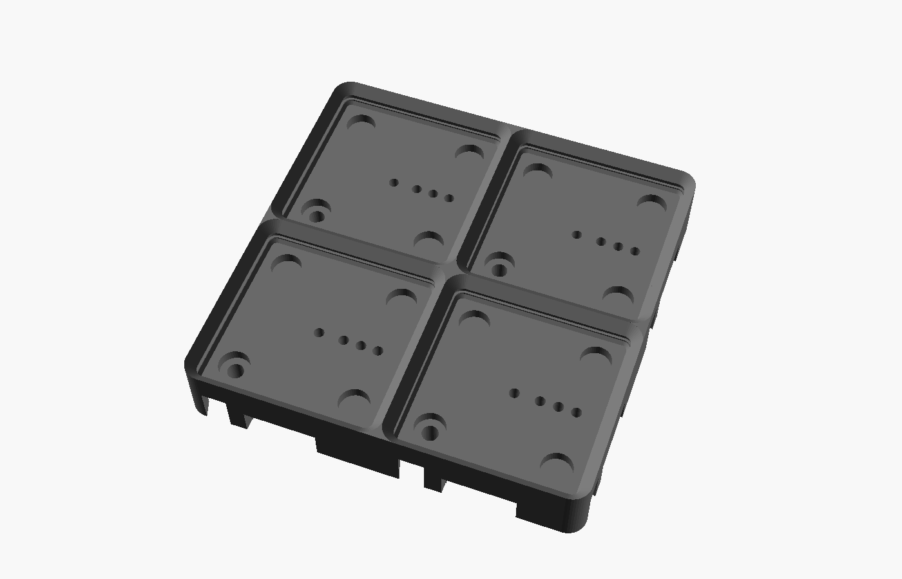 | 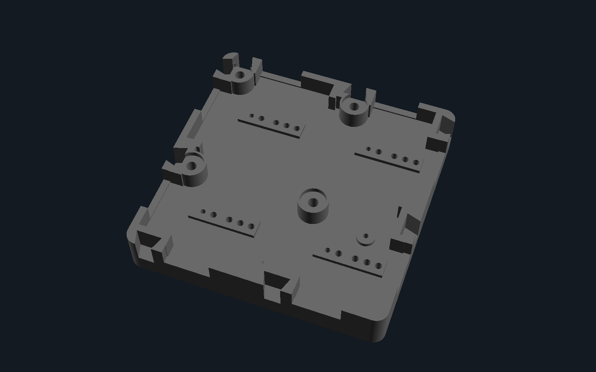 |

*Top: four magnet pockets and four pin holes per cell. Underside: an open cavity for the
boards, with notches in the outer wall for edge connectors and keys.*

### Boards inside a tile

One board lies under every row of cells, with that row's spring pins already soldered on.

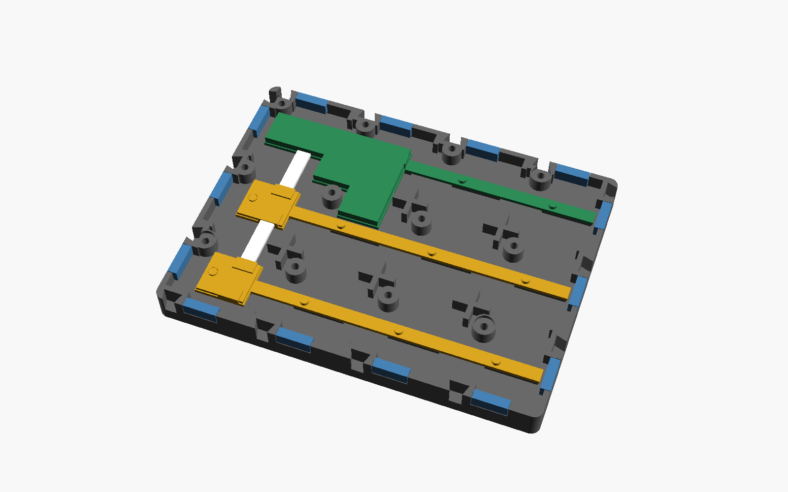

*Green: the first row's board. Gold: the strips of the further rows. White: flat cables.
Blue: edge connectors.*

- **First row's board** has the radio module and the converter that makes 5 V from the
  12–24 V feed. It picks one row and one cell at a time.
- **Row strips** under the further rows each carry one small switch chip.
- **A flat cable** joins each row to the next: 12 conductors, 30 mm, a stock part.
- **One board length fits all tiles.** Boards are four cells long and can be snapped shorter.

Fitting is: push the pins up through their holes, drive one small screw per cell, plug the
cables. No soldering happens at the printed tile.

### Joining tiles

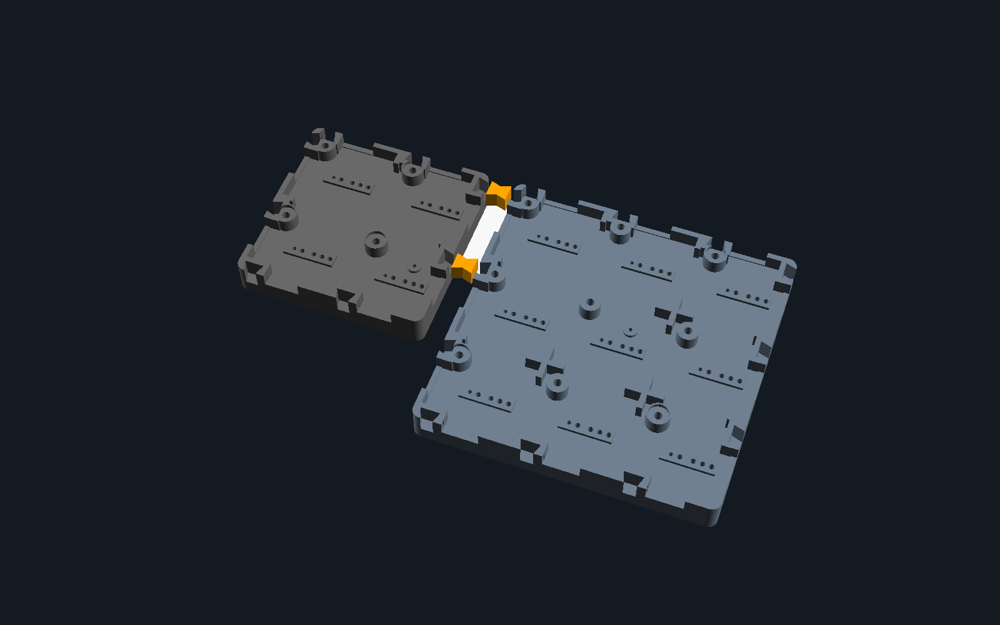

- Push two tiles together and the magnetic edge connectors snap. That makes the electrical
  joint and holds the tiles. No screws, no tools.
- Printed bow-tie keys are optional. They lock a permanent or wall-mounted grid.
- One connector pair per pair of touching tiles is enough for power and for finding each other.
- Tiles are at most 4 cells each way and at least 2×2. Mix sizes freely.

## Power

- A 12–24 V supply plugs into the power bin, which stands on the power cell of the starter tile.
- Edge connectors pass 12–24 V from tile to tile. Each tile steps it down to 5 V for its own
  cells, so a bin never sees more than 5 V.
- The higher voltage is what lets one feed reach far: by calculation, about 26 tiles in a
  row at 12 V and 52 at 24 V, against 9 at 5 V.

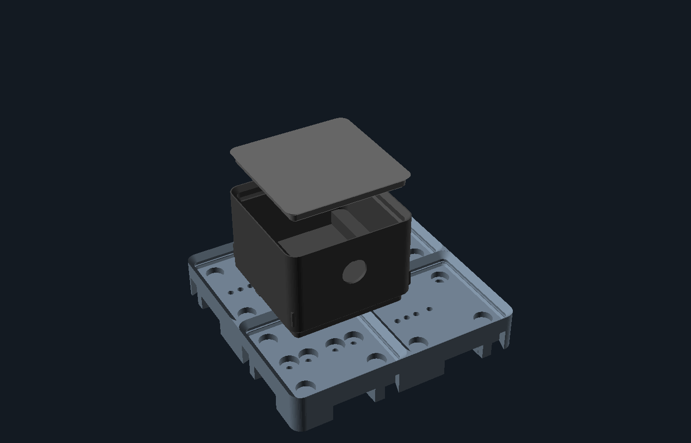

The power cell's four feed pins sit in wells below the socket floor, so a normal bin's flat
foot cannot touch them. The power bin has four screw heads that reach down. It seats in two
positions, both with the right polarity, and does not seat a quarter turn off.

## The bin

| Opened | From below |
|---|---|
| 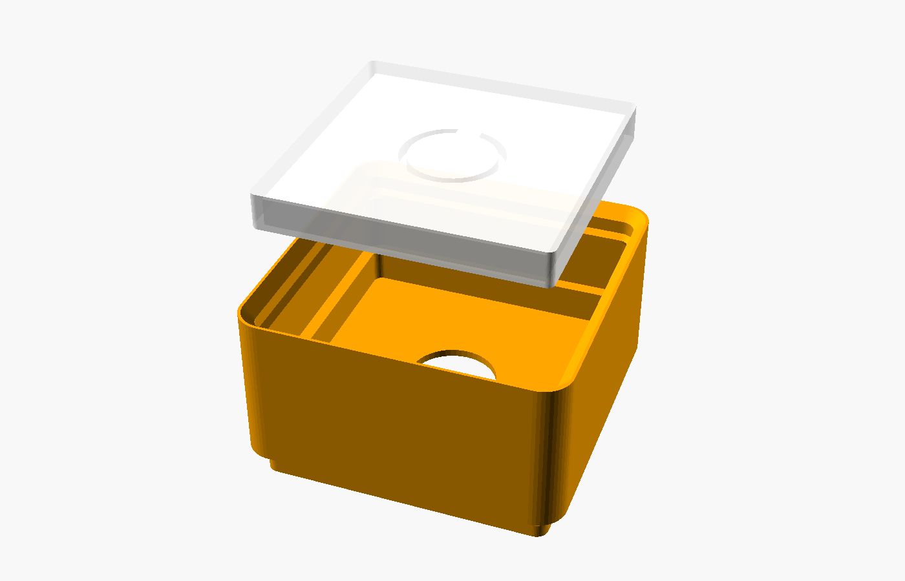 | 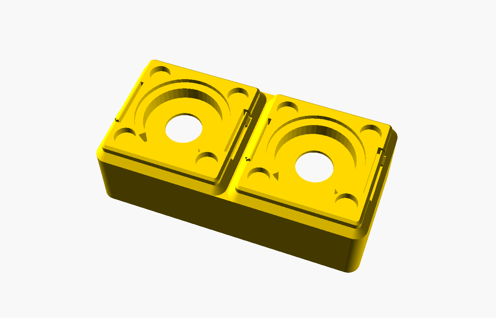 |

A bin is a body in any colour plus one clear false floor per compartment. The false floor
takes 4.6 mm of height, so a smart bin is at least 3 units (21 mm) high.

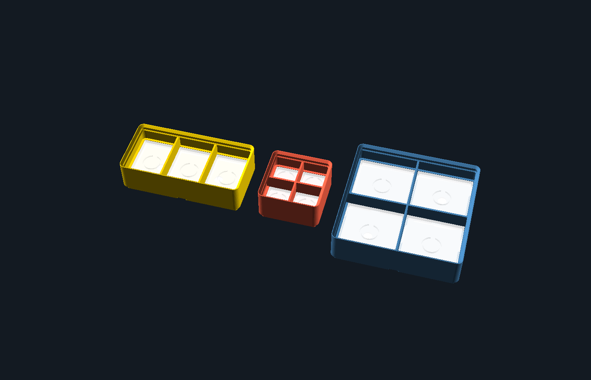

- Compartments can be any count across and front to back. Dividers stop light spilling over.
- Label tabs are an option per bin.
- Clear sleeves are optional inserts that carry the light up around a jar.

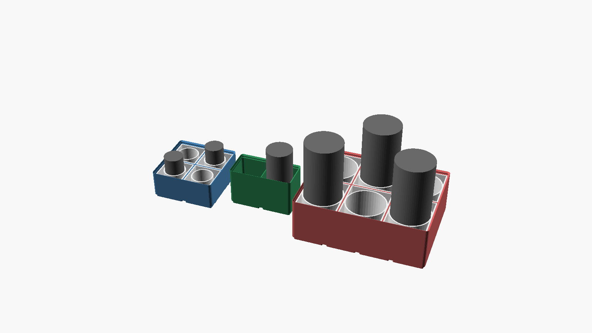

## The drawer unit

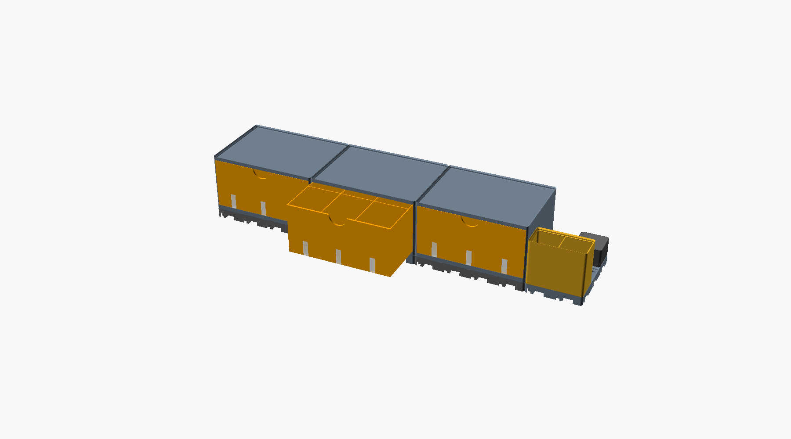

A drawer unit is a smart shell, 4×3 cells and 13 units high, around a plain drawer. The
shell has the electronics; the drawer has none, so nothing connects or disconnects when it
slides. A clear strip on the front shows which drawer and column to open.

## A whole collection

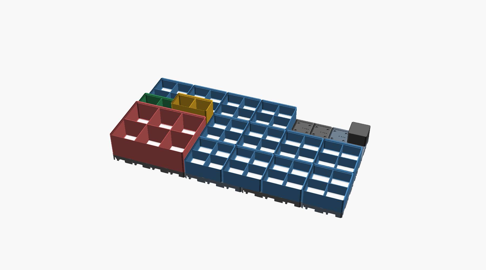

The scenario used to test the plan: 48 paint jars, 8 bottles, a pen holder and the power bin
on eight tiles of three sizes, 72 cells in all. In simulation, the hub placed all 8 tiles
and all 16 bins correctly, including bins that sit across a joint. It draws about 5.4 W.

## How this maps to standard Gridfinity

| Standard part | Smart version |
|---|---|
| Magnet or screw-down baseplate | The smart tile: magnets built in, one pocket per cell takes a wall screw |
| Connectable baseplates | Magnetic edge connectors plus optional bow-tie keys |
| Plain bin, divider bin | Smart bin with any number of compartments, 3 units or taller |
| Stacking lip | Kept: smart bins stack, and standard bins stack on them |
| Item holders | A compartment bin plus a clear insert; the jar sleeve is the first |
| Drawers | The drawer unit |
| Label tab | An option on any smart bin |
| Plain open-frame baseplate | Not adaptable (no floor for pins); still useful unpowered |
| Half-pitch plates, bins under 3 units, vase-mode bins | Not possible |

## Next

- Every part and which file makes it: [Parts guide](parts-guide.md)
- What has been verified: [Status and open questions](status.md)
- What to buy: [Materials list](smart/parts.md)
- The boards in detail: [`pcb/README.md`](../pcb/README.md)
