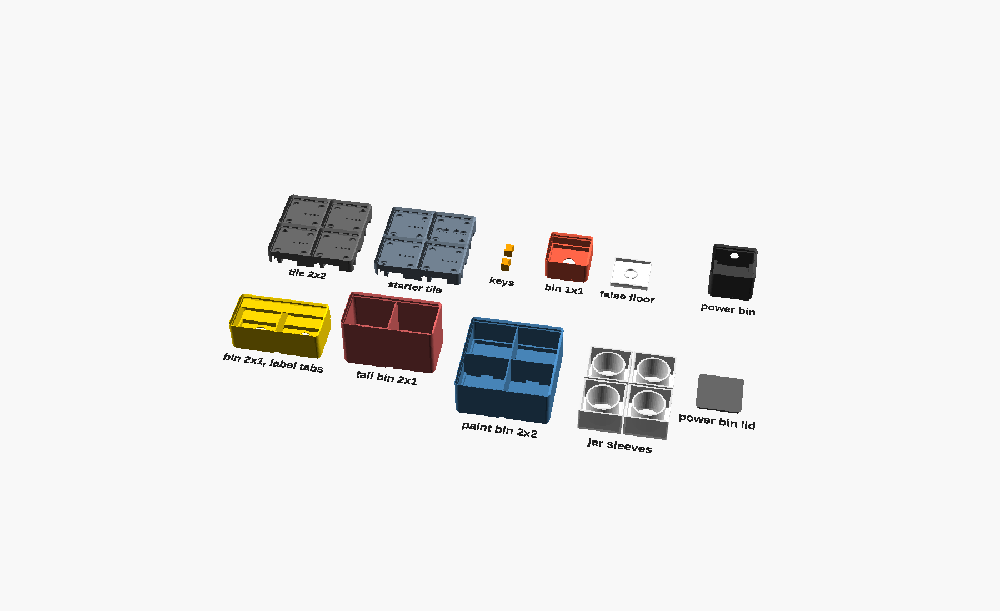
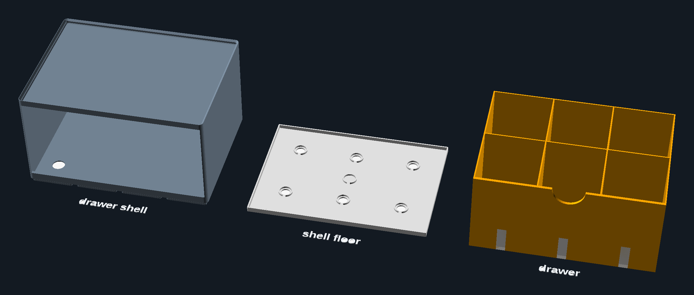
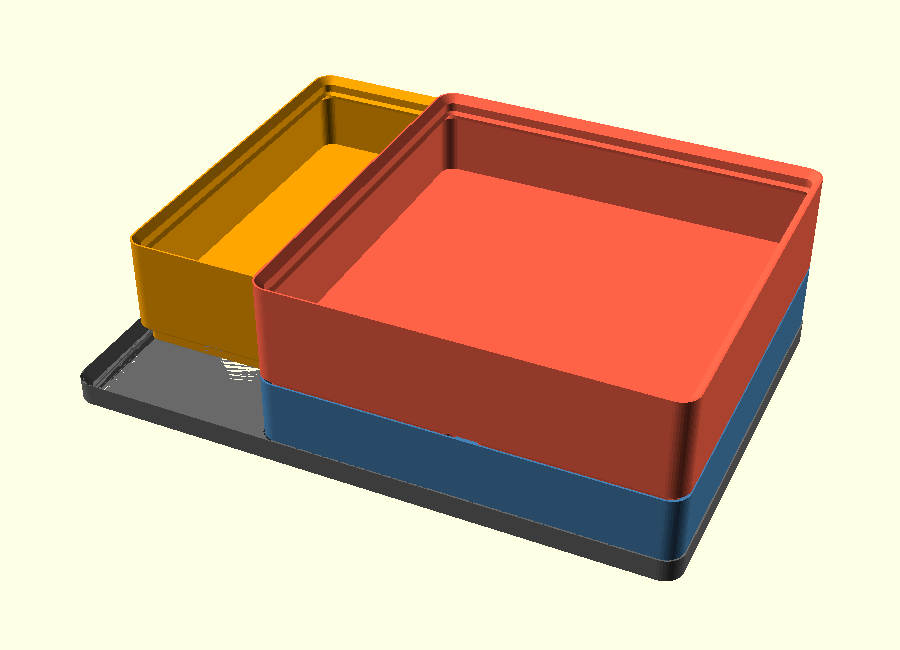
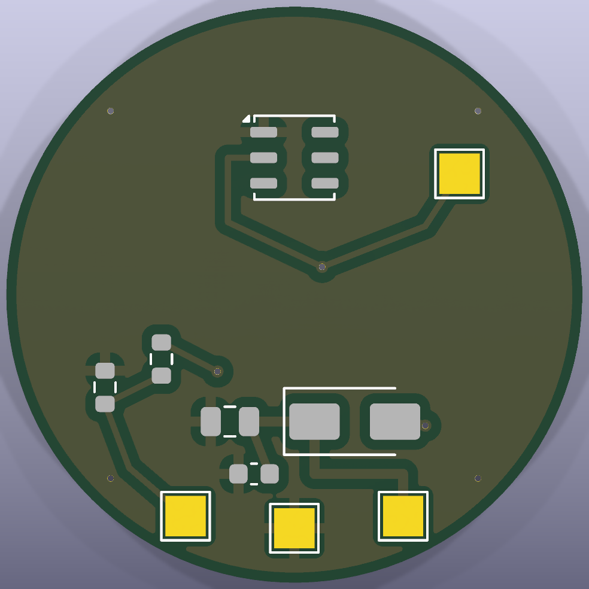
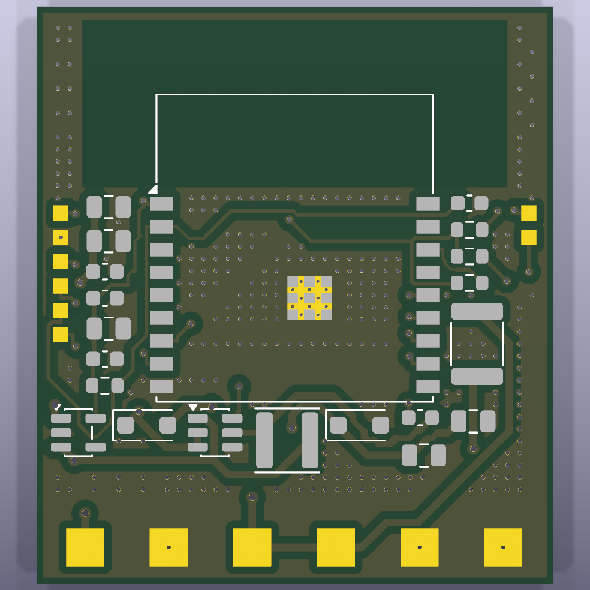
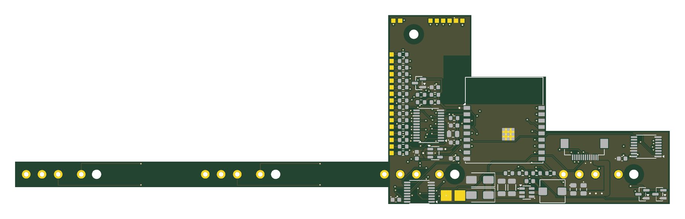
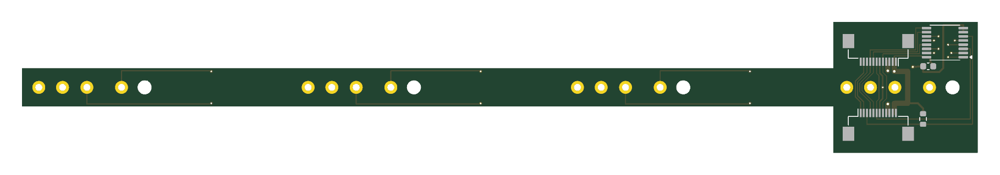

# Parts guide

Every part of the system: what it is, which file makes it, and how to print or order it.
New to the project? Read [How it works](how-it-works.md) first.

## Printed parts

Each part is one OpenSCAD file in `parts/`. Sizes are parameters, so one file makes every
size. The STL names are the ones in the [release](https://github.com/lookatitude/smart-gridfinity/releases)
and in `build/` after running the build scripts.

### Smart parts

| Part | Source file | Main parameters | Example STL | Notes |
|---|---|---|---|---|
| Tile | `parts/smart_base.scad` | `cells_x`, `cells_y` (2 to 4 each) | `tile_3x3_print4.stl` | Needs supports under the socket floor |
| Starter tile | `parts/smart_base.scad` | as above, `power_cell=true` | `starter_tile_2x2.stl` | One per power feed. The power cell is the back-right corner |
| Bow-tie key | `parts/tile_key.scad` | none | `tile_key_print4.stl` | Optional. Locks two tiles from below |
| Bin body | `parts/smart_bin.scad`, `part="body"` | `cells_x`, `cells_y`, `units_z` (3 or more), `compartments_x`, `compartments_y`, `label_tabs` | `test_bin_2x1_body.stl` | Any colour |
| False floor | `parts/smart_bin.scad`, `part="floor"` | same as the body | `test_bin_2x1_floor_clear.stl` | Clear filament. One piece per compartment in one file |
| Jar sleeve | `parts/jar_sleeve.scad` | the bin's sizes, `jar_diameter` | `paint_bin_2x2_sleeve_clear.stl` | Optional. Clear filament |
| Power bin | `parts/power_bin.scad`, `part="body"` or `"lid"` | none | `power_bin_body.stl`, `power_bin_lid.stl` | Goes only on the power cell |
| Drawer unit | `parts/drawer_unit.scad`, `part="shell"`, `"floor"`, `"drawer"`, `"clear"` | none | `drawer_unit_4x3_shell.stl` | 4×3 cells, 13 units high. Shell prints standing on its back wall |

### Plain parts

These are ordinary Gridfinity parts with no electronics. They work on their own and
alongside the smart parts.

| Part | Source file | Main parameters | Example STL |
|---|---|---|---|
| Baseplate | `parts/baseplate.scad` | `cells_x`, `cells_y` | `baseplate_2x2.stl` |
| Baseplate larger than the bed | `parts/baseplate_tiled.scad` | `cells_x`, `cells_y` | `baseplate_9x7_tile_4x4_print1.stl` (split into tiles automatically) |
| Bin | `parts/bin.scad` | `cells_x`, `cells_y`, `units_z` | `bin_1x1x3.stl` |

### Reading an STL name

- `_print4` means print four copies.
- `_clear` means clear filament.
- `_body` and `_floor` are the two halves of one bin.
- `label` means the bin has label tabs.

## Printing

- **Bed:** sized for a 256 mm bed. Change `lib/printer.scad` for another printer.
- **Nozzle:** 0.4 mm for smart parts. Some features are too fine for 0.6 mm.
- **Supports:** smart tiles need them under the socket floor. Other parts do not.
- **Floors and sleeves** come as one file with one piece per compartment. Use "split to
  objects" in the slicer to arrange them. Floors are already turned plate-down.
- **Measure first:** openings for spring pins, edge connectors, the DC socket and screw heads
  are estimates. Check them against the parts you buy before printing many tiles.
- **Nothing has been test-printed yet.**

To build STL files yourself (OpenSCAD 2021.01 or newer):

    ./build.sh          # plain parts into build/
    ./build_smart.sh    # smart parts into build/smart/

To make a size that is not in the scripts, open the part's file in OpenSCAD and change the
parameters in the Customizer, or add a line to `build_smart.sh`.

## Circuit boards

Five custom boards, meant to be ordered assembled. All are unreviewed drafts. Details,
contact order and fabrication files are in [`pcb/README.md`](https://github.com/lookatitude/smart-gridfinity/blob/main/pcb/README.md).

| Board | Folder | Goes where | Per tile or bin |
|---|---|---|---|
| Bin board | `pcb/bin_board/` | Glued into a bin foot | 1 per bin, plus 1 bare board for a second foot |
| Row board, first row | `pcb/row_main/` | Under the first row of a tile | 1 per tile |
| Row strip | `pcb/row_strip/` | Under every further row | 1 to 3 per tile |
| Feed board | `pcb/feed_board/` | Under the power cell | 1 per starter tile |
| Power board | `pcb/power_board/` | Inside the power bin | 1 per power bin |

| | |
|---|---|
|  |  |
|  |  |

Each board folder holds the KiCad project, a parts list (`bom.csv`), rule-check reports,
pictures and fabrication files (`fab/`).

## Bought parts

Magnets, LEDs, flat cables, edge connectors, screws, rubber feet, a DC socket and a power
supply. They are listed by specification, with quantities for three build sizes, in the
[materials list](smart/parts.md).

## Changing a model

- `lib/constants.scad` holds the Gridfinity standard: 42 mm pitch, 7 mm height unit.
- `lib/smart.scad` holds every dimension the smart parts share: pin positions, board
  envelopes, socket sizes. **The circuit boards must match this file.**
- If you change a pin, hole, board outline or socket position, change `pcb/layout_rows.py`
  too, then run both checks:

      python3 pcb/check_rows.py    # boards against the model
      tests/fit.sh                 # nothing collides (over 10 minutes)

- `parts/smart_base.scad` also contains "ghost" modules: solid stand-ins for boards, cables
  and connectors. They are not printed. The fit checks use them.
- `assembly_smart.scad` produces the pictures. Set its `view` variable to pick one.
